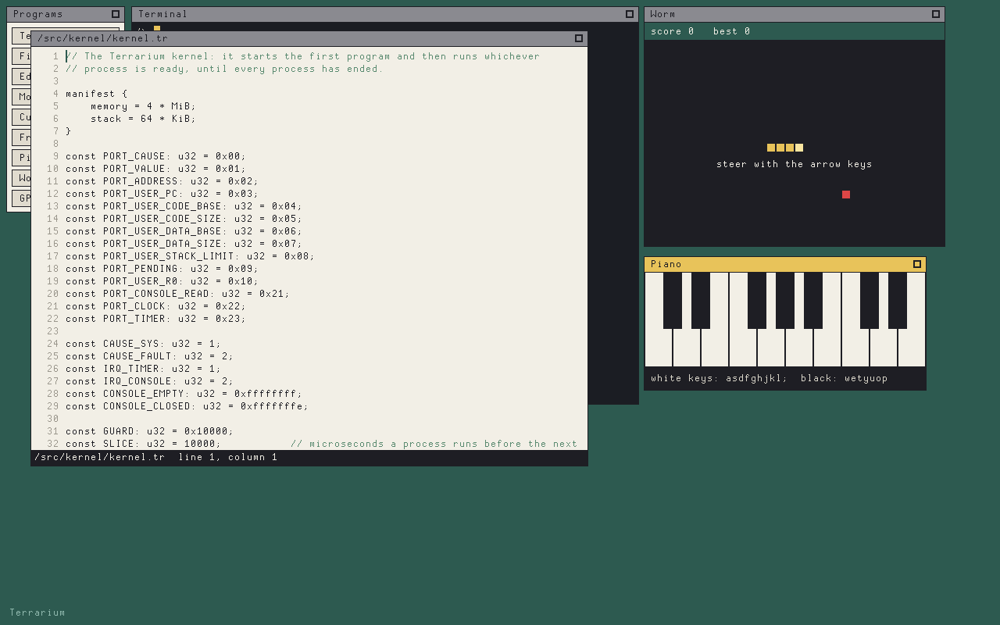

# Terrarium

A tiny computer built from scratch, small enough to understand from its
first instruction to its desktop. The machine — a 32-bit CPU, a GPU, sound,
disk and network devices — is C. Everything that runs on it is written in
Terrarium's own assembly and language: the assembler, the compiler, the
kernel, the window system, the shell and the programs.


```sh
make            # the machine, the tools (built by themselves), and a disk
make run        # boot Terrarium in a window; this terminal becomes its console
make test       # instructions, faults, the language, and whole-system sessions
```

It needs a C11 compiler and SDL3.

## What's inside

| Part                          | Written in | Lines |
| ----------------------------- | ---------- | ----- |
| The machine (`src/`)          | C11        | 3,000 |
| The assembler (`system/asm/`) | assembly   | 2,500 |
| The compiler (`system/tc/`)   | the language | 3,400 |
| The kernel (`system/kernel/`) | the language | 2,800 |
| Libraries (`system/lib/`)     | both       | 1,600 |
| 39 programs (`system/bin/`)   | the language | 5,000 |

- **The CPU** has eight registers, 45 instructions of one word each, and
  16.16 fixed-point multiply and divide instead of floating point. Each
  program gets one contiguous block of memory, with null pointers and stack
  overflows caught by the hardware.
- **The language** is small and C-like: explicit types, structs, enums,
  bounds-checked slices, `fixed`, and arenas instead of a heap. A program
  declares all its memory up front, and what it's allowed to do.
- **The kernel** runs programs with preemptive multitasking, pipes, a file
  system, windows, sound and networking. It enforces each program's
  permissions, keeps memory back for recovery tools, and slides programs
  together in memory when free space is in pieces.
- **The GPU** draws PS1-style: fills, lines, text, images, and shaded or
  affine-textured triangles. Windows draw straight into the one shared
  framebuffer, clipped to the parts other windows don't cover.
- **Text is UTF-8** everywhere. Terra, the system font, is drawn as text in
  `system/fonts/terra.txt` and covers ASCII and Latin-1.



## Inside Terrarium

The desktop starts with a launcher and a terminal. Programs live in `/bin`
(`help` lists them), libraries in `/lib`, the documentation in `/docs`, and
the whole system's source in `/src`.

```
/> cd /src
/src> tc -o hello.asm /lib/core.tr hello.tr
/src> asm -o hello /lib/rt.asm hello.asm
/src> ./hello
Hello from the Terrarium language!
/src> sh /src/scripts/build-tc
```

The last line rebuilds the compiler inside Terrarium and checks that the
result is byte for byte the compiler the host built. Some others to try:

- `edit file` — a text editor (Ctrl-S, C, X, V, F); `files` — a file browser
- `paint`, `view` — draw pixel art and look at TIM1 images
- `cube`, `fractal`, `demo` — fixed-point 3D, Mandelbrot, the GPU
- `worm`, `life`, `piano`, `calc`, `clock` — two games, an instrument, and
  two tools
- `monitor`, `ps`, `mem` — memory reserved and instructions used; the
  monitor can stop a process
- `manifest /bin/edit` — what a program declares about itself
- `trace ls` — every system call a program makes; `search text files...`
  — the lines that contain some text; `sort`; `hex file` — its bytes
- `serve 8080` — share the current directory; then `curl localhost:8080/`
  on the host. `fetch host port /path` goes the other way.

## On the host

The tools are Terrarium programs too. On the host they run on the
development monitor, which runs one program and lends it the host's files:

```sh
build/terrarium build/tc.bin -o build/hello.asm system/lib/core.tr examples/hello.tr
build/terrarium build/asm.bin -o build/hello.bin system/lib/rt.asm build/hello.asm
build/terrarium build/hello.bin
build/terrarium build/mkimage.bin -o picture.tim picture.bmp    # BMP to TIM1
```

`build/terrarium [--trace] [--stats] program.bin [arguments...]` runs a
program on the monitor. `--trace` prints every instruction and `--stats`
the cycle count; a `program.sym` next to the program (the assembler writes
one with `-s`) puts label names in traces and fault reports.

`build/terrarium boot [--headless] [--fullscreen] [--mute] disk.img
[kernel.sym]` starts the whole machine. For testing, `--screen WxH` gives it
a screen without a window, `--type text` presses keys once it has started,
`--run-for ms` stops it, and `--screenshot out.png` saves the screen. In
`--type`, a newline is Enter, `\x1b` is Escape, `\b` is Backspace, and other
control characters are Ctrl with a letter. `--drag x0,y0,x1,y1` drags the mouse after the
typing, and `--date seconds` stops the clock at one moment.

The assembler and compiler build themselves from seeds in `bootstrap/`; see
its README.

## Documentation

| Spec                                   |                                     |
| -------------------------------------- | ----------------------------------- |
| [isa.md](spec/isa.md)                  | the CPU, kernel mode, ports         |
| [devices.md](spec/devices.md)          | console, timer, disk, video, GPU, input, sound, network |
| [assembly.md](spec/assembly.md)        | the assembly language               |
| [language.md](spec/language.md)        | the Terrarium language              |
| [executable.md](spec/executable.md)    | programs, memory, permissions       |
| [system.md](spec/system.md)            | system calls, windows, tracing      |
| [filesystem.md](spec/filesystem.md)    | the disk                            |
| [formats.md](spec/formats.md)          | images and the other file formats   |

[docs/notes.md](docs/notes.md) explains the decisions behind the design,
where it differs from the original plan, and what it doesn't do yet.
